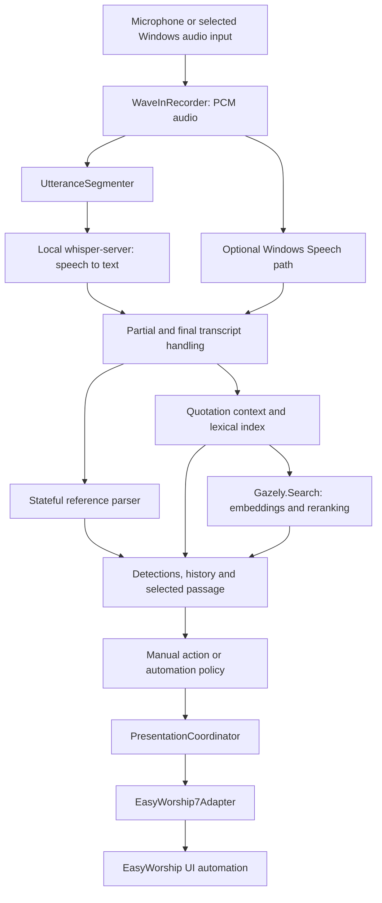

# Gazely: technical guide for a Python engineer

Implementation snapshot: 2 October 2026, following source baseline `686e2da`.
This describes the code that exists, not the finished product architecture.
Use [ENGINEERING_HANDOFF.md](ENGINEERING_HANDOFF.md) for dated changes and evidence,
[EXECUTION_PLAN.md](EXECUTION_PLAN.md) for future work, and this guide for how the
pieces fit together. All paths below are relative to the repository root.

October 9 evaluation note: Moonshine Medium and Small are available in the staged
experimental application build, using an isolated Python worker and continuous
native streaming. Automatic presentation is disabled for this engine. Operator
testing exposed sustained backlog; neither model is an accepted production
replacement. `benchmarks/replay_moonshine.py` exercises streaming and optionally
the existing C# semantic-search worker. See the handoff for measurements and the
initial source-only Nemotron/Parakeet assessment. Both candidates were subsequently
downloaded with permission on October 11; see the dated handoff for their status.

October 12 streaming integration: `StreamingSpeechEngine` shares one bounded PCM
transport between the Moonshine and Nemotron workers. It creates one worker per
listening session, not per packet. Moonshine keeps one `Transcriber.start()` session
and feeds `add_audio`; Nemotron keeps one native cache-aware recognition stream via
the pinned runtime's loopback WebSocket API. Neither path repeatedly writes WAVs,
recreates models, or retranscribes accumulated windows. The 100 ms PCM packets are
transport units, not independent recognition jobs.

Nemotron's `nemotron_worker.py` uses four CPU threads, right-context 6 (560 ms),
and 700 ms endpointing. Its local server binds only 127.0.0.1 with a random session
token; it never calls a hosted ASR service. A Windows job object cleans up the
server when the worker exits or is killed. EOF waits for native commit confirmation.
Ordered WebSocket ping/pong acknowledgements also work during silence, unlike text
events. Diagnostics report received/acknowledged samples, bounded queue occupancy
and acknowledgement roundtrip. The latter includes queuing/transport/decoding;
it is not pure model compute time or latency from the end of a spoken reference.
The runtime can still buffer its normal lookahead after acknowledging a packet.

The C ABI in v0.2.0 omits configurable CPU threads; the initial bridge using its
default thread policy overran in a paced replay. The WebSocket route passed two
102-second paced bridge sessions and full-app replays with retrieval. The
four-minute Genesis replay had 0.3-second maximum sampled backlog and all final
audio flushed. The first RSS sampler cached worker readings and undercounted
memory; do not use its 1.13–1.15 GB totals as acceptance evidence. This does not establish that
thread count alone caused the original overrun. The alternative transcribe.cpp
Moonshine benchmarks use a different runtime/weight format from our ONNX route;
they are a reason to compare runtimes, not directly comparable performance evidence.

Select **Nemotron English (experimental)** in Speech setup. Whisper remains the
default, and native streaming results cannot trigger automatic presentation.
The worker currently locates evaluation assets under `benchmarks/tools`; deployable
runtime packaging remains outstanding. A clean four-minute Genesis full-app replay
matched the file benchmark's 65/449 word errors (14.48%). The sampler now refreshes
worker counters and includes the actual Python process behind the Windows venv
launcher. See the handoff for corrected memory evidence. Native audio acknowledgements
measure transport progress, not completion of all lookahead or end-of-speech latency.
The corrected 102-second rerun measured 1.68 GB combined peak working sets across
the UI, speech and retrieval processes, with 0.3-second maximum sampled backlog.
The candidate is staged through the existing restart updater; the prior executable
remains available for rollback. Longer endurance and 8 GB hardware validation remain.

## 1. What the product actually runs

October 11 UI addition: `MainForm.MiniOverlay` in `GazelyInterface.cs` is another
WinForms view over the existing MainForm, not a second controller or recognizer.
It polls UI state at 250 ms, uses existing history snapshots and RunDetected,
and persists namespaced preferences through WorkspacePreferences. Window APIs
provide non-activation, bounds/anchoring and minimize detection. The full form
stays alive while hidden; a tray shortcut restores it. See the handoff for the
operator-monitor constraint, output-capture limitations and regression evidence.

Gazely is a Windows desktop application with optional local speech and search processes.
There is no cloud inference dependency, generative chatbot,
LangChain pipeline, vector database server, or fine-tuned Gazely model in the
current application.

The intelligence consists of several different mechanisms:

1. **Speech recognition:** pretrained Whisper models turn audio into text; the
   experimental streaming engines use local worker processes as described above.
2. **Reference interpretation:** C# rules and state recognize references such as
   “Genesis forty-nine verse three,” ranges, translations and contextual navigation.
3. **Quotation retrieval:** lexical lookup plus embedding retrieval and a neural
   reranker find Bible verses whose wording or meaning resembles the transcript.
4. **Presentation policy:** decides whether a result can be automated or needs review.
5. **Presentation adapter:** translates an approved scripture action into EasyWorship
   operations. Recognition itself does not need EasyWorship to interpret scripture.

The UI label **Local AI** means our local Whisper integration. It does **not** mean
the separate open-source product named LocalAI.



**Process boundaries:**

| Process | Technology | Responsibility | Communication |
|---|---|---|---|
| `Gazely.exe` | C#, .NET Framework, WinForms | Audio capture, orchestration, parser, lexical search, UI, adapter | Main application |
| `whisper-server.exe` | Native whisper.cpp runtime, pinned setup build `b5130` | Whisper inference | HTTP on a session-specific `127.0.0.1` port |
| `Gazely.Search.exe` | C#, .NET 8, ONNX Runtime 1.20.1 | Embeddings, dense retrieval, cross-encoder reranking | Redirected stdin/stdout; stderr diagnostics |

The search worker is a separate process because the modern inference stack is in
.NET 8 while the desktop shell remains on .NET Framework. It is persistent once
started, so we do not reload the embedding and reranker models for every query.
The speech server likewise stays loaded for a listening session.

## 2. Repository map and where to edit

The long application directory name is historical; it is still the active source
folder. Below, **app/** means `EasyWorshipController_MVP_v6_2_CODEX_HANDOFF/`.

| File or directory | What you will find |
|---|---|
| `app/EasyWorshipController.cs` | Entry point, core data types, native audio, both speech backends, parser, canon metadata, lexical search, semantic subprocess client, most orchestration and older UI construction |
| `app/GazelyInterface.cs` | Other half of `MainForm`, modern workspace layout, custom controls, themes, candidate/history UI and preference persistence |
| `app/PresentationAdapters.cs` | Adapter contract, presentation intent/result types, coordinator, integration preferences, EasyWorship 7 adapter |
| `app/ChapterPronunciationRecovery.cs` | Bounded phonetic recovery of a misheard chapter number using Windows speech synthesis phonemes |
| `app/SemanticSearch/Program.cs` | Tokenization, ONNX inference, vector index loading/building, retrieval and reranking |
| `app/SemanticSearch/Gazely.Search.csproj` | SDK-style .NET 8 worker project and ONNX dependency |
| `app/corpus/` | KJV display/retrieval text, WEB retrieval text, provenance and notices |
| `app/assets/`, `Brand Assets/` | Packaged icon/symbol and original brand assets |
| `app/Build-EasyWorshipController.ps1` | Desktop compilation through the .NET Framework CodeDOM compiler |
| `app/SETUP_LOCAL_WHISPER.ps1` | Speech runtime/model installation |
| `app/SETUP_SCRIPTURE_SEARCH.ps1` | Pinned compact-model downloads, worker publishing and vector index construction |
| `app/Test-*.ps1` | Parser, retrieval, UI, audio and adapter regression harnesses |
| `benchmarks/` | Python evaluation utilities, C# audio replay harness, PowerShell runners and tracked result summaries |

The codebase is still a prototype with a large central file. The conceptual layers
are clearer than their physical separation. `MainForm` owns considerable business
orchestration, and several tests extract or combine source text. Moving or renaming
classes can therefore break test harnesses even when the application logic is sound.
There is no main desktop `.csproj` or conventional test solution yet; the worker has
its own `.csproj`.

### C# concepts translated into Python terms

| C# construct here | Python comparison and important difference |
|---|---|
| `namespace EasyWorshipControllerMvp` | Roughly a package namespace; historical name, not a product boundary |
| `partial class MainForm` | One class split across source files, merged by the compiler; not two form instances |
| `internal sealed class` | Assembly-internal type that cannot be subclassed |
| `ScriptureDetection` / `ScriptureRequest` | Similar to mutable dataclasses with explicitly typed fields |
| `event Action<T>` | Callback subscription, using `+=` and `-=` |
| `delegate`, `Func<bool>` | Function values/closures; the latter is a no-argument boolean function |
| `lock (gate)` | Like a lock context manager protecting shared state |
| `ThreadPool.QueueUserWorkItem` | Dispatching work to a thread pool, not an asyncio coroutine |
| `BeginInvoke` | Schedule a callback on the WinForms UI thread |
| `IDisposable`, `using` | Deterministic cleanup, like a context manager; important for processes, streams and inference sessions |
| `IPresentationAdapter` | An enforced interface, similar to a Python Protocol/ABC |
| LINQ `Select`, `Where`, `GroupBy` | Mapping, filtering and grouping collections |

Do not assume the desktop compiler supports the modern C# syntax used by the .NET 8
worker. Keep desktop changes compatible with its existing compiler until that build
system is deliberately migrated.

## 3. Audio and transcription

`WaveInRecorder` uses Windows native audio APIs; the speech pipeline consumes
16 kHz, mono, signed 16-bit PCM. At that format, 32,000 bytes represent one second.
`OnAudioData` routes bytes either to `UtteranceSegmenter` for Whisper or through
`BlockingAudioStream` to `LiveSpeechRecognizer` for Windows Speech.

### The actual speech models

| UI profile | Model resolved by code | Model file available on this development machine | Approximate file size, decimal MB |
|---|---|---|---:|
| Fastest | Whisper `tiny.en` | `ggml-tiny.en.bin` | 77.7 |
| Balanced | Whisper `base.en` | `ggml-base.en.bin` | 148.0 |
| More accurate | Whisper `small.en` | `ggml-small.en-q5_1.bin` fallback | 190.1 |

The `small.en` resolver prefers `ggml-small.en.bin` if installed, otherwise accepts
the compact Q5_1 file above. The setup script's `small.en` download and the existing
quantized local file are not interchangeable size claims. The table describes local
files, not the total installed size or a promise about download size for every setup.
Whisper is pretrained; we have not trained it on this preacher or accent.

There is also a roughly 0.9 MB Silero VAD file. **Neural VAD is disabled by default**:
earlier sermon evaluation worsened with that configuration. The normal segmentation
path currently uses an adaptive audio-energy threshold, not Silero inference.

`UtteranceSegmenter` keeps around 400 ms of pre-roll, uses a noise-floor estimate
and hysteresis, and finalizes after about 360/400/440 ms of silence according to
profile. It caps an utterance at 6.5 seconds and carries roughly one second of audio
across forced cuts. That overlap helps references spanning a boundary, but can also
produce repeated transcript words.

When early results are enabled, partial snapshots start at a 1.2-second interval;
the worker adapts that interval up to 6 seconds when inference is slow. Finals take
priority over waiting partials. The audio queue is capped at two items and drops
old queued audio if necessary to stay current. **That is a latency/completeness
tradeoff:** overload can mean missed speech, not merely a late display.

`WhisperServerEngine` sends WAV bytes to `/inference`, requests English, uses
temperature 0 and no temperature increment, with beam size 1 for tiny and 3 for
base/small. The scripture vocabulary prompt is deliberately empty: earlier prompting
caused unspoken Bible names and translation tokens to appear. Audio normalization
and repetition filtering live in `SpeechVocabulary`.

### Optional audio refinement and evaluation

`RecentSpeechAudio` retains 20 seconds of 16 kHz PCM16 in a 640 KB ring and exposes
sample-indexed snapshots capped at 16 seconds. `ReferenceRefinement` schedules
same-engine recovery only after live queued jobs, with a conservative 800 ms
estimated inference budget. Jobs carry session, intent revision, anchor, source
voice time and sample span. Two attempts per intent, three-second spacing and a
four-second source-voice deadline bound work. Late/stale results are discarded;
accepted results are review-required and never auto-present. Correction requests
may reuse the prior chapter/verse through the existing correction parser.

The persisted experimental toggle is off until evaluation demonstrates benefit.
A 12-variant development run admitted no recovery jobs on this PC, so this is
infrastructure rather than a demonstrated accuracy improvement. Default model,
window, endpoint, normalization and neural-VAD settings remain unchanged.

The replay harness supports `-BeamSize`, `-RawAudio`, `-Refinement`, `-Retrieval`,
`-WindowMs`, and `-EndpointMs`. Use `Run-HearingMatrix.ps1` for sequential ablations;
never compare accelerated replay times to live latency. It records audio/source/model
hashes, sample spans, dropped jobs and process resource measurements. Human-verified
annotations are required by `score_reference_events.py`; the template deliberately
marks unchecked timestamps unverified. An optional 336 MB Distil-Whisper artifact
is checksum-pinned by the evaluation downloader, not selected automatically.

### Why live text and committed transcript differ

These are revisable hypotheses versus final utterance results, not two independent
recognizers passing text through a needless second transcription stage. Partials
can immediately populate the provisional reference UI, but cannot automate output.
Final text goes through `OnFinalTranscript`, gets a timestamp, updates parser state
and schedules quotation work. Under a narrow unchanged-audio condition the worker
can reuse its last partial result for the final, avoiding another inference.

Useful latency breakdown:

```text
time after last voiced sample
  = endpoint waiting + queued work + inference + interpretation/UI dispatch
presentation latency additionally includes the adapter action
quotation latency additionally includes retrieval/reranking and its queue
```

The local Whisper callback passes `1.0` as an internal confidence argument. This is
**not a measured 100% speech confidence**. The UI does not label it that way.
Windows Speech supplies its own confidence, which is also a different quantity from
reference confidence or retrieval similarity.

## 4. Explicit scripture parsing and conversational state

Start with `ScriptureDetector`, `BibleCanon`, `ScriptureDetection` and
`SpeechPresentationPolicy` in the main source file.

`ScriptureDetector` normalizes text and applies book aliases, number interpretation,
reference patterns and contextual rules. It can retain incomplete book/chapter
calls, join suitable later fragments, detect ranges and handle instructions such
as “next verse.” `BibleCanon` validates actual chapter/verse limits and moves to an
adjacent verse. It is metadata, not an AI model.

`ScriptureDetection` carries:

- Canonical book, chapter, verse and optional range end.
- Requested translation and whether the speaker explicitly requested it.
- `SourceText`: what the recognizer actually returned.
- `MatchedText`: retrieved Bible wording, where applicable.
- `EvidenceKind`, `Reason`, `RequiresReview`, `Confidence` and `MatchScore`.

Preserve the distinction between what was **heard** and what was **inferred**.
Do not rewrite the transcript to make a successful match appear more accurate.

For “Genesis 49:3–4,” parsing retains the range; `SpeechPresentationPolicy.Resolve`
projects the spoken result to verse 3 for sequential presentation. Manually entered
ranges keep their range. A clear “next verse” can advance an anchored reference.
There is no current read-the-entire-verse confirmation model, and bare “go” does
not automatically advance.

Chapter pronunciation recovery is a separate hypothesis generator. It obtains
phonemes from an installed English Windows voice, compares the suspect chapter
phrase with pronunciations of valid chapter numbers, and applies distance/margin
checks. For example, it may recover “for tonight” as “forty-nine” in a clearly
identified chapter slot. It discards synthesized audio, requires review, and is
not a general rule converting arbitrary words into numbers.

## 5. What our “RAG” currently is

Strictly, it is a **hybrid scripture retrieval system**, not full
retrieval-augmented generation. There is no final LLM prompt producing an answer,
no generated verse text, and no Qwen model. The output is an existing canonical
reference and stored Bible text.

### Corpus and document units

`corpus/kjv.tsv` contains 31,102 verse documents; `web-search.tsv` adds 31,095 WEB
documents. Each row is `book<TAB>chapter<TAB>verse<TAB>text`. A document is one verse,
not a paragraph assembled from several verses. WEB gives retrieval modern wording;
both versions map to canonical KJV references. The preview remains KJV. The
presentation adapter may use a different explicitly requested translation.

Preserve corpus provenance and notices. Neither corpus is extracted from the
operator's installed EasyWorship database.

### Path A: lexical retrieval

`ScriptureQuoteIndex` builds an in-memory inverted index from normalized KJV words
to verse IDs. It removes a substantial stop-word list, weights informative terms,
and searches overlapping phrase windows. Candidates are evaluated for weighted
word coverage and word order using a longest-common-subsequence calculation.

This is a custom scoring implementation, **not BM25**. Current gates include
coverage >= .82, ordered-match ratio >= .75, a final weighted score >= .88, and a
lead over the second candidate (.025 globally, .08 in chapter-scoped lookup).
Additional shared-word/rarity rules apply. `FindAll` searches multiple phrases and
deduplicates references rather than returning only one match for the entire sermon.
Lexical matches remain review-required.

### Path B: semantic retrieval and reranking

| Stage | Installed model artifact | Role | Approximate weights |
|---|---|---|---:|
| Embedding | `Xenova/bge-small-en-v1.5`, quantized ONNX | Maps passages and queries to 384-dimensional vectors | 34.0 MB |
| Reranking | `cross-encoder/ms-marco-MiniLM-L6-v2`, `model_quint8_avx2.onnx` | Scores each query/candidate pair together | 23.2 MB |

`SETUP_SCRIPTURE_SEARCH.ps1` is the authority for pinned revisions, exact remote
filenames and SHA256 checks. The combined weights are about 57.2 MB. An earlier
measurement of runtime, models, indexes and corpus was about 252.5 MB; speech
models and developer dependencies are additional. Experimental E5 support in the
worker does not mean E5 is installed or is the production path.

The sequence in `SemanticSearch/Program.cs` is:

1. **Tokenize.** The local `Bert` helper implements lowercasing, accent stripping,
   basic token splitting and WordPiece lookup using the model vocabularies. It
   builds input IDs, attention masks and segment IDs. This is handwritten code,
   not the Hugging Face tokenizer runtime; parity deserves regression coverage.
2. **Embed the corpus once.** BGE uses the first-token/CLS output, then L2
   normalization. Index construction batches 16 similarly sized documents.
3. **Persist vectors.** `kjv-vectors.bin` and `web-vectors.bin` contain float32
   vectors and identity metadata tied to corpus, model, vocabulary and pooling
   configuration. Model quantization does not make these stored vectors int8.
4. **Embed the query.** BGE receives the query prefix
   `Represent this sentence for searching relevant passages: `.
5. **Retrieve.** Compute dot products against all normalized vectors, equivalent
   to cosine similarity, and retain the top 32 document variants. This is an exact
   in-memory scan and sort, not FAISS, HNSW, Chroma or a hosted vector store.
6. **Rerank.** MiniLM jointly reads query and candidate text and emits a relevance
   logit. A cross-encoder is more expensive per pair than a dot product, so it
   only sees the shortlist.
7. **Group and gate.** Sort by reranker score, group variants by canonical KJV
   reference, retain the best variant per group, then require cosine >= .55 and
   logit >= 0. Return up to three references per query.
8. **Publish evidence.** The desktop client resolves canonical IDs back to KJV
   entries, creates `paraphrase` detections and marks every one review-required.

Token budgets are bounded: 190 content tokens for a single embedding input and
253 combined content tokens for a pair, plus special tokens. Long input is
truncated. ONNX sessions currently use two intra-op threads and one inter-op
thread. This is a CPU-oriented path; no GPU is required by the implementation.

The desktop keeps cosine as `MatchScore`; the reranker logit influences worker
ranking/filtering but is not retained in the current detection object. A “90%”
similarity display therefore does not mean 90% probability that the preacher
quoted that verse. Likewise, lexical and semantic scores are not directly
comparable calibrated probabilities.

### Context and result merging

Current candidate quality gate: review-only semantic candidates need at least
seven words of source evidence and a MiniLM reranker score of 4.5 or higher;
each phrase keeps at most three qualified alternatives. A completed 30-minute
paced replay reduced paraphrase rows from 240 to 32 while preserving its 10
explicit and 15 lexical quotation rows. This does not establish real-sermon
precision or authorize automatic paraphrase output.

`FindQuotation` searches the current transcript, lexical context and explicit
references found in separate book spans. It merges distinct references rather than
using a learned fusion model or reciprocal-rank fusion.

- Lexical context retains up to 12 chunks / 120 words / 30 seconds, with reset
  after a 15-second gap.
- A recently named book/chapter provides a 90-second quotation scope.
- Semantic search starts with current phrases. If evidence is missing, or current
  evidence does not match a named chapter, it can make one continuation query from
  the latest two chunks, capped at 40 words.
- Candidate history can accept late results, but an old revision cannot replace
  the current selected passage.
- Operator selection/editing holds the selected passage until Release scripture.
- `ActiveReferenceState` holds confirmed, provisional and retained unconfirmed intent through book,
  chapter and resolved-reference stages (updated 6 October). There is no elapsed-
  time release of SP. Parser context is seeded from confirmed or retained intent; incomplete finals preserve the more complete candidate with an Unconfirmed label. Retained candidates require review and cannot automate output. Previews
  cannot commit it. All quotes continue to Detections but cannot take active SP.
  Explicit references/corrections and manual actions can switch it. A supported
  transition phrase plus a strong current-text lexical match (>= .94, not an
  ambiguous parallel passage) can switch SP as a review-required quotation.
  Semantic similarity alone cannot perform that switch.

Strong unambiguous lexical quotes also enter a bounded SP alternative list below
the main reference. This uses independent snapshots: operator quote selection
changes the displayed passage, while `activeReference` continues following speech.
Returning to the spoken anchor preserves the other quotes. The SP list displays
up to 20 items; History remains the full session record. Quote selection alone
never sends a presentation command.

This explains why **a candidate appearing in Detections**, **becoming Selected
passage**, and **being sent live** are three separate events.

### Calling the worker from Python

Python can exercise the exact deployed semantic worker without rewriting it.
After setup, start it with model directory and KJV TSV arguments. It writes
`READY`, accepts one Base64-encoded UTF-8 query per line, and replies with
semicolon-separated `canonicalRowId,cosine,logit` records. Empty line means no
accepted result; `ERROR` means query failure. IDs are zero-based KJV file row IDs.

```python
import base64
import subprocess
from pathlib import Path

app = Path("EasyWorshipController_MVP_v6_2_CODEX_HANDOFF").resolve()
worker = subprocess.Popen(
    [str(app / "search-runtime/Gazely.Search.exe"),
     str(app / "models/scripture-search"), str(app / "corpus/kjv.tsv")],
    stdin=subprocess.PIPE, stdout=subprocess.PIPE,
    # Inherit stderr: do not leave a redirected error pipe undrained.
    text=True, encoding="utf-8",
)
try:
    assert worker.stdout.readline().strip() == "READY"
    query = "Put God's kingdom first and the things you need will follow"
    worker.stdin.write(base64.b64encode(query.encode()).decode() + "\n")
    worker.stdin.flush()
    print(worker.stdout.readline().strip())
finally:
    worker.stdin.close()
    try:
        worker.wait(timeout=5)
    except subprocess.TimeoutExpired:
        worker.kill()
        worker.wait()
```

This is a small blocking developer example. A production client needs startup/query
timeouts, cancellation, error handling and continuous stderr draining if captured.
The C# client has 30-second startup and 10-second query timeouts, terminates failed
workers, and uses a one-minute retry cooldown while lexical search remains available.

## 6. Threading, stale results and UI state

WinForms controls belong to their UI thread. Worker callbacks must use `BeginInvoke`
before changing them. Audio inference runs on a thread-pool worker with a bounded
queue. Quotation jobs use a separate serial queue so the semantic subprocess has
one request/response exchange at a time. The quotation queue is not equivalently
bounded; sustained throughput and long-service memory remain engineering risks.

Three identifiers matter when debugging stale results:

- **Listening session:** rejects results from a previous capture session.
- **Utterance/revision:** separates revisable partials from final results and stops
  older interpretation from replacing newer selected content.
- **Candidate epoch:** Clear advances this so queued pre-clear results cannot
  repopulate the cleared panel.

The modern UI lives in `GazelyInterface.cs`, but shares fields and handlers with
the original `MainForm` definition. It is not MVVM. Custom WinForms controls draw
rounded cards/buttons, toggles and icons. Candidate cards cache unchanged control
instances; `BufferedDetectionPanel` batches layout/redraw to avoid blinking.
Actions use saved detection snapshots so a refresh cannot silently change what a
clicked Present button means.

Preferences persist as escaped key/value text in `gazely-preferences.txt` beside
the app using temporary-file replacement. Integration enablement is stored separately
at `%LOCALAPPDATA%/Gazely/integrations.txt`. Bible version indexes are installation-
specific `version-map.txt`. Transcript, History and detections remain in-memory
session state. Restoring Automatic Live does not start listening or issue output.

## 7. Automation and adapter boundaries

`SpeechPresentationPolicy.CanAutomate` requires all of:

```text
not RequiresReview
Confidence >= 0.88
EvidenceKind is explicit or navigation
```

Other runtime checks still apply: automation enabled, destination enabled, not busy,
valid current state and duplicate suppression. The same automatic signature is
suppressed within 12 seconds. A clear anchored next/previous-verse instruction can
be promoted to score .90. Partial text, quotes, semantic paraphrases and phonetic
recovery do not become automatic-live instructions merely because a score is high.
Manual Present is immediate operator authorization; no per-send confirmation.

`PresentationIntent` snapshots scripture and action details. The coordinator checks
capabilities, serializes command attempts, uses cancellation generations and caches
the last 256 intent outcomes. Reusing an ID for different content is an error.
This gives bounded session-level attempt deduplication, **not a durable exactly-once
delivery guarantee** across crashes/restarts.

`EasyWorship7Adapter` delegates to `EasyWorshipAutomation`, which uses Windows UI
automation and input operations. New speech references default to KJV unless the
speaker requests another translation. `BibleVersionPosition` tracks navigation,
while bounded read-only UIA/MSAA probes try to observe the selected library
translation. Manual Present and automatic Live now use the same mapped/tracked
position when readback is unavailable. A saved map seeds the KJV-first startup
assumption; completed navigation is reused in the same EasyWorship process, so
repeated Present on the same version sends no scroll keys. A fresh readable row
overrides that tracked position, and a readable mismatch blocks the send. Reset
version tracking discards the position and reanchors from the top on the next
send. An external EasyWorship version change can leave the tracker out of sync;
the operator should reset tracking after changing versions there. The visible
library is sorted by abbreviation. Overlapping screenshots verified the complete
24-row LIGHT NATION_1 list, but this order is specific to that EasyWorship profile;
the results table's Trans… live readback remains unverified. The live slide is a
separate state and cannot establish library selection. Reset version tracking
explicitly invalidates cached position.

A new installation starts with no assumed version indexes until its map is saved. The first-run guide
leads to **Bible versions**, where read-only `header.abbrev_name` values from the
modern local `.ewb` SQLite plugins propose a code-sorted list. The user compares
it with the full visible EasyWorship Scriptures library, edits mismatches, and
confirms before Gazely saves its own `version-map.txt`. Enter and commas both
separate manual entries. Older-format or unreadable plugins cannot establish the
visible list, so guided manual entry remains available. Exclude “More Available…”
and recheck after EasyWorship profile or catalogue changes. Saving returns to
Live workspace. A valid map does not prove the selected library translation;
the KJV-first operating assumption is deliberate for this release. Direct
EasyWorship selection changes cannot currently be detected reliably.

The adapter returns `SentUnverified`, not `LiveVerified`: successfully issuing the
operation is not proof of the actual audience screen. Stop/disable can invalidate
pending work, but cannot undo a command already sent.

Only EasyWorship 7 is currently implemented. EasyWorship 2009, ProPresenter,
FreeShow and BibleShow are future adapters; their settings entries do not constitute
working integrations. Adding one means implementing `IPresentationAdapter`, truthful
capabilities, connection/setup UX and coordinator tests. The current intent is
scripture-specific; songs, slides and media will require a broader content contract.
Automatic adapter downloads/plugin discovery are not already built.

## 8. Build, test and debug workflow

For an offline Windows setup build, run `Build-PublicPackage.ps1` after building
`Gazely.mvp-candidate.exe`, then `Build-WindowsInstaller.ps1` with the ZIP path.
The package builder selects required files explicitly, verifies both installed
speech packages offline and excludes the local Bible map and preferences. The
installer embeds the ZIP and `Install-Gazely.ps1` in one EXE. The install script
checks the archive and file manifest before moving files into a versioned folder
under `%LOCALAPPDATA%/Programs/Gazely`; it creates a Start Menu shortcut and a
per-user Windows Installed apps entry without admin rights. Each package has an
uninstaller that removes its own versioned folder and its shortcut only if that
shortcut still targets it. `%LOCALAPPDATA%/Gazely` settings and history stay in
place. Earlier installers did not register an uninstaller, so remove their
versioned folder manually after closing Gazely if no longer needed. No download
is part of this path. The setup EXE is unsigned.

From the repository root, use **Windows PowerShell** for the desktop build:

```powershell
Set-Location EasyWorshipController_MVP_v6_2_CODEX_HANDOFF
powershell -NoProfile -ExecutionPolicy Bypass -File .\Build-EasyWorshipController.ps1 -OutputFileName Gazely.exe
.\RUN_GAZELY.bat
```

The build compiles four C# source files, treats warnings as errors, packages branding
and preserves a failed build's last good executable. If Gazely is open, it can stage
`Gazely.pending.exe`; the launcher activates it after closing the app. A developer
may need to install Windows .NET Framework components, but the desktop build does
not require Visual Studio or NuGet. The .NET 8 SDK is needed to build the semantic
worker; its published self-contained runtime does not require an end-user SDK.

Setup scripts download models; do not rerun them casually when changing UI/parser
code. Downloaded models, binaries, local settings and raw runs are intentionally
excluded from Git. A fresh clone is source, not an installed application.

| Test | What it protects |
|---|---|
| `Test-ScriptureParser.ps1` | Explicit references, aliases, numbers, ranges and context; existing suite has 330 cases |
| `Test-QuotationIndex.ps1` | Lexical retrieval, multiple quotes, scoped matches and presentation policy |
| `Test-SemanticSearch.ps1` | Real installed model retrieval, positives/negatives, reported-sermon/held-out fixtures |
| `Test-PresentationAdapters.ps1` | Fake adapter lifecycle, cancellation, outcomes and intent semantics |
| `Test-VersionNavigation.ps1` | Version position tracking and navigation decisions |
| `Test-Interface.ps1` | Layout, candidate actions, history, stale results, held selection and preference restore |
| `Test-SpeechPipeline.ps1`, `Test-AudioPipeline.ps1` | Speech/audio pipeline behavior |
| `Test-ChapterRecovery.ps1` | Pronunciation recovery hypotheses |
| `benchmarks/Run-LiveReplay.ps1` | Replays audio through production segmentation/worker logic |
| `benchmarks/score_transcript.py`, `test_scoring.py` | Transcript scoring and scorer regression checks |

For example, from app/:

```powershell
powershell -NoProfile -ExecutionPolicy Bypass -File .\Test-ScriptureParser.ps1
powershell -NoProfile -ExecutionPolicy Bypass -File .\Test-QuotationIndex.ps1
powershell -NoProfile -ExecutionPolicy Bypass -File .\Test-Interface.ps1 -OutputDirectory ..\benchmarks\runs\my-ui-check
powershell -NoProfile -ExecutionPolicy Bypass -File .\Test-SemanticSearch.ps1 -HeldOut -OutputCsv ..\benchmarks\runs\my-ui-check\semantic.csv
```

Use a new UI output directory each run. Semantic tests require installed models
and indexes. UI/adapter checks use fakes rather than sending real projection commands.
Historical raw evidence and external sermon audio are not included in Git; small
tracked reports do not imply every referenced recording is available in a clone.

### Trace a failure by layer

1. **Wrong words:** inspect raw transcript and saved/replayed audio; investigate
   capture, clipping/noise, segmentation, queue drops and ASR before changing retrieval.
2. **Right book/chapter/verse but no detection:** reproduce with parser text fixtures.
   Check canonical validation, split utterances, unresolved state and context expiry.
3. **Quote missed:** test the text directly against lexical lookup and semantic
   worker; inspect top candidates with `-Diagnostics`, then test split-chunk context.
4. **Detected but not selected:** inspect revision/session/epoch, operator hold,
   recent-explicit protection and chapter scope in `PublishQuotations`.
5. **Selected but not automatic:** inspect `RequiresReview`, evidence kind,
   `CanAutomate`, toggles, duplicate signature and destination/busy state.
6. **Action sent but wrong screen/version:** inspect adapter state/version mapping;
   do not treat `SentUnverified` as successful live verification.

`scripture-diagnostics.log` and Diagnostics expose transcript/timing information.
Logs may contain service speech; they remain local and ignored by Git.

## 9. Current limits and a sensible internal development path

Offline inference works, but we have not established 99% transcription accuracy,
arbitrary-paraphrase recognition, or good performance on every 8 GB PC. Earlier
semantic tests measured roughly half a second p95 query time and around 450–480 MiB
worker memory on this machine. Those figures exclude Whisper, UI queues, audio
endpointing and EasyWorship. They are not complete product latency or memory totals.

Known risks include noisy ASR, repeated overlap, dropped audio under load, finite
parser context, false semantic matches for ordinary anecdotes, one-verse retrieval
units, score calibration, unbounded quotation backlog, and limited live readback.
The 90-second quote scope is distinct from the parser's shorter context lifetime;
one timer does not solve the other. Search-index identity deliberately rejects stale
corpus/model combinations: a changed embedding model requires rebuilding indexes,
not merely replacing the ONNX file.

For a Python engineer, the fastest contribution route is to use Python for replay,
evaluation, corpus experiments and querying the worker, while editing the bounded
C# component responsible for the behavior. Python is not needed on the end user's
machine. If a later Python prototype wins on measured quality/latency, it can become
a process behind a stable interface; packaging, startup, memory and distribution
size must be evaluated before making it a production dependency.

Recommended refactoring order, separate from current shipped behavior:

1. Lock down reproducible audio/text fixtures and measure ASR WER, reference recall,
   quotation precision/recall, false suggestions on non-scripture speech, and p50/p95
   **end-to-end** latency independently.
2. Extract parser, retrieval and presentation policy from `MainForm` into testable
   modules; replace source-slicing tests with ordinary projects as part of that work.
3. Define typed inference/candidate contracts with separate acoustic, retrieval,
   reranking and policy scores. Retain provenance instead of one ambiguous percentage.
4. Bound/coalesce quotation work with explicit stale-job rules, while preserving
   useful history evidence; measure the effect before changing live behavior.
5. Add adapters through the existing boundary, then generalize content intents for
   songs/media when those workflows have concrete requirements.

Keep a negative-test set as seriously as a successful-quote set. Improving recall
by showing every loosely related verse is not the same as improving operator trust.
